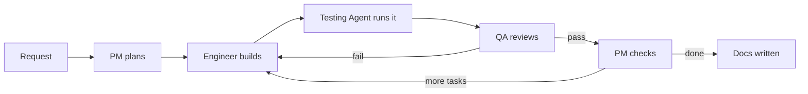

<div align="center">

# AI Development Team

**Five agents that plan, build, test, review and document software. Every decision about what happens next is plain Python.**

[](https://ai-dev-team.wm-waleedmaqbool.workers.dev)
[](https://github.com/waleed-w-maqbool-m/ai-dev-team/actions/workflows/tests.yml)


</div>

<br>

You give it a request in plain English. A **Project Manager** plans the work, a **Software Engineer** writes the code, a **Testing Agent** runs it, a **QA Reviewer** judges it, and a **Documentation Agent** writes it up. It runs on a local model through Ollama (Qwen3 8B by default) or on Groq's free hosted API.



## What makes it different

| | |
|---|---|
| **Routing is code, not chat** | Every "what next" decision lives in [`graph/routing.py`](graph/routing.py) and reads typed state. Models fill in fields. They never steer. |
| **Evidence, not opinions** | The Testing Agent is not an LLM. It parses, imports and starts the code the Engineer wrote, and QA reviews with that report in hand. |
| **A sandbox for model-written code** | With Docker, checks run in a throwaway container: no network, read-only filesystem, non-root, memory and CPU limits. |
| **Every loop is bounded** | QA can send a task back 3 times and clarification gets 2 rounds. After that the task is set aside for a human and the run moves on. |
| **Output is validated** | Each reply must parse into its schema, or the model is re-prompted with the error. File paths cannot escape the workspace. |

The longer design rationale is in [`ai-dev-team-architecture.md`](ai-dev-team-architecture.md). Where it and the code disagree, the code is right.

## Does it actually work?

`bench/` runs the whole pipeline on **12 tasks** and scores the result with **66 hidden test cases** the agents never see. Every task has a reference solution that CI checks against its own tests, so the expected outputs are verified too.

The report also tracks the **false "done" rate**: runs where QA approved everything but the code still fails the hidden tests. That is how often the team's own review is wrong. A switch turns the Testing Agent off, so you can measure what it is worth.

```bash
python -m bench.run --name llama-3.3-70b --provider groq --model llama-3.3-70b-versatile
python -m bench.report     # writes bench/RESULTS.md
```

## Quick start

Needs Python 3.12 or newer.

```bash
pip install -r requirements.txt

# pick one model backend
export LLM_PROVIDER=groq GROQ_API_KEY=gsk_...    # hosted, free tier
#   or: ollama pull qwen3:8b && ollama serve     # local, the default

python main.py "Build a CLI tool that converts CSV files to JSON."
```

Files are written to `workspace/`. Runs are checkpointed to SQLite, so an interrupted run can resume, and every agent message is logged as JSONL.

### Web console

```bash
cd frontend && npm install && npm run build && cd ..
python api.py        # then open http://127.0.0.1:8000
```

A 3D stage with one station per agent. **Story** walks through the graph, **Theater** streams or replays a run, **Runs** lists every recorded run, and **Benchmark** shows the real numbers. The server binds to `127.0.0.1` only because it executes model-written code, so never expose it publicly. The public site is a replay-only build on Cloudflare Workers.

## Settings

| Variable | Default | Meaning |
|---|---|---|
| `LLM_PROVIDER` | `ollama` | `ollama` or `groq` |
| `GROQ_API_KEY`, `GROQ_MODEL_NAME` | none, `llama-3.3-70b-versatile` | Groq key and model |
| `AI_TEAM_MODEL`, `OLLAMA_BASE_URL` | `qwen3:8b`, `http://localhost:11434` | Ollama model and server |
| `AI_TEAM_WORKSPACE` | `./workspace` | Where generated files go |
| `AI_TEAM_SANDBOX` | `auto` | `auto`, `docker` or `subprocess` |
| `AI_TEAM_TESTING` | `on` | `off` skips the Testing Agent |

## Tests

```bash
pip install -r requirements-dev.txt
pytest
```

The model is mocked at one seam, so no key or model is needed. The suite covers the full graph, retry caps, bad PM answers, path confinement, the Testing Agent's real checks and the benchmark's reference solutions. CI runs it on Python 3.12 and 3.13, with and without the Docker sandbox.

## Honest limits

- Tasks run one at a time.
- A clarification round re-plans the whole task list.
- The Testing Agent proves code parses, imports and starts. It does not write behavioral tests. Only the benchmark does, and only for scoring.
- Without Docker, generated code runs on the host with a scrubbed environment and a timeout. Do not point `AI_TEAM_WORKSPACE` at anything you care about.
- The Docker image has only the standard library, so code needing third-party packages fails its import check there.
